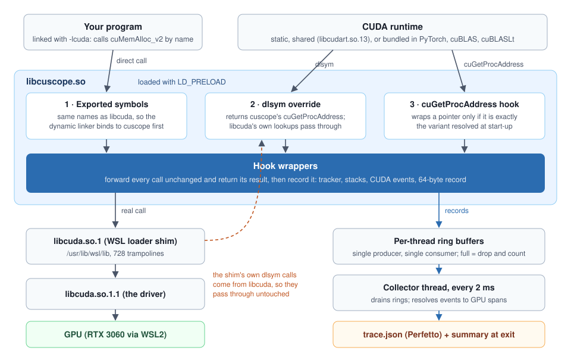

# cuscope design

This is the design as built for v0.3.0. It started from the Phase 1 spec
([superpowers/specs/2026-10-21-cuscope-phase1-design.md](superpowers/specs/2026-10-21-cuscope-phase1-design.md))
and records the decisions and findings made while building it on an RTX 3060 Laptop GPU
under WSL2 (Windows driver 617.14, CUDA 13.0).



## 1. Goal and the hard part

cuscope is an `LD_PRELOAD` library that sees every driver call an unmodified CUDA program
makes, whether the CUDA runtime is linked statically (nvcc's default), shared, or bundled by
PyTorch. All of them reach the GPU through `libcuda.so.1`, loaded dynamically, so the driver
is the one layer common to every program.

The hard part is that the runtime does not call driver functions by name. It `dlopen`s
libcuda, fetches `cuGetProcAddress` with `dlsym` on that handle, and then asks for each
function by base name, CUDA version and stream flags. A handle lookup never consults
`LD_PRELOAD`, so preloading alone sees none of it.

## 2. Three paths into the driver

| Path | Who uses it | How cuscope gets in |
|---|---|---|
| 1. Exported symbols | programs linked with `-lcuda` | cuscope exports the same names; the preloaded library binds first |
| 2. `dlsym(handle, ...)` | the CUDA runtime fetching `cuGetProcAddress` | cuscope exports `dlsym` and returns its own `cuGetProcAddress` |
| 3. `cuGetProcAddress(name, version, flags)` | the runtime, for every driver function | cuscope's `cuGetProcAddress` calls the real one, then swaps in a wrapper when the pointer is the expected variant |

### The WSL loader shim

On WSL, `/usr/lib/wsl/lib/libcuda.so.1` is a 188 KB loader. It `dlopen`s the real driver
(`libcuda.so.1.1`) and fills a table of over 700 functions with `dlsym`, through cuscope's override.
Handing it a wrapper would make the wrapper call the shim and the shim call the wrapper,
forever. So the override first asks `dladdr` which module called it, and passes through
everything libcuda asks for itself. The census counted 739 such lookups per process.

That check must match `libcuda.` or `libcuda_` exactly. The first version matched the prefix
`libcuda`, which also matches `libcudart.so.13`: every lookup from the shared runtime, and
PyTorch's main runtime, went through unrecorded. The real-GPU census caught it
(`hello_shared` showed 0 lookups); a fake `libcudart.so.13` in the mock suite now covers it.

### Wrapping the right variant

The runtime asks for each function at its own minimum version (`cuMemAlloc` at 3020,
`cuLaunchKernel` at 4000, or at 7000 with the per-thread-stream flag), never at 13000. A
wrapper has one signature, so cuscope must never hand it out for a different variant. At
start-up the loader resolves each hook's expected pointer through the real
`cuGetProcAddress`, for both stream variants, at the version in `hooks.def`. At lookup time
it compares pointers, not version numbers: an exact match gets the wrapper, anything else
passes through untouched and is counted as a `mismatch` in the census.

Two hooks need a version other than `CUDA_VERSION`:

- `cuCtxSynchronize` at 2000. At 13000 the driver returns `cuCtxSynchronize_v2(CUcontext)`,
  while `cuda.h` declares the base name `(void)`. Resolving at 13000 would hand a `(void)`
  wrapper the `_v2` pointer.
- `cuDevicePrimaryCtxRelease` and `cuDevicePrimaryCtxReset` at 7000, with v1 export names.
  The runtime releases its context through v1; hooks resolved at 13000 never saw it.

Each wrapper's signature is checked against `cuda.h` at compile time (`CS_REGISTER`'s
`static_assert`). `tools/check_exports.py` checks the other half against the installed driver:
for every hook and both variants, `cuGetProcAddress(base, version, flags)` on the real
`libcuda.so.1.1` must return the same function as `dlsym` of the export the wrapper was
written for. A negative control asserts that `cuCtxSynchronize` at 13000 is *not* the `(void)`
function.

cuscope's own driver calls (events, context queries) use `CS_DRIVER_FN(fn)`, which builds both
the C++ type and the exported symbol name from the same token, so they cannot disagree. The
first version resolved them through `cuGetProcAddress` at 13000 and crashed inside the driver
on every run: `cuCtxGetDevice` at 13000 is `cuCtxGetDevice_v2(CUdevice*, CUcontext)`.

### Initialisation order

`dlsym` can be called before cuscope's constructors run: the WSL shim calls it from its own
constructor. Everything reachable from the hooks is therefore constant-initialised (POD,
zero-initialised atomics, `constexpr` tables) or set up on first use (`pthread_once`,
function-local statics). Start-up has two stages that never wait on each other: finding the
real `dlsym` (with `dlvsym`, so it never re-enters the override) and loading libcuda. A
`dlsym(RTLD_DEFAULT, "cuGetProcAddress_v2")` would find cuscope's own export, so pseudo-handle
lookups resolve through libcuda, and no pointer inside `libcuscope.so` is ever accepted as
"real".

### The `dlsym` override

`RTLD_NEXT` means "the next object after the caller", and glibc finds the caller from the
return address of the `dlsym` call. A C++ override that calls the real `dlsym` makes
`libcuscope.so` the caller, so `RTLD_NEXT` from any library (a malloc or pthread
interposer, say) searched the wrong objects. The exported `dlsym` is therefore a small
assembly trampoline (`src/dlsym_trampoline.S`): it asks `cuscope_dlsym_decide` whether to
answer (a `cuGetProcAddress` name, or a hooked export looked up on libcuda's handle) and
otherwise restores the arguments and jumps to the real `dlsym` with the caller's return
address still on the stack.

## 3. Recording

```
wrapper (program thread)                     collector thread (every 2 ms)
  capture check, start event ── real call ──   drain every ring into one list
  end event, 64-byte Record ─► per-thread  ──► query pending events, convert to spans
                               SPSC ring        return events to the pool
```

- **Records.** One 64-byte `Record` per call: type, hook id, thread, CPU time and duration,
  pointer, bytes, stream, function, correlation id, stack id. Each thread pushes into its own
  single-producer, single-consumer ring of 16,384 records; a full ring drops the record and
  counts it, never blocking the program. A thread that exits marks its ring finished (a
  `pthread_key` destructor); the collector drains it once more and frees it. After the exit
  drain the collector is never restarted.
- **Allocations.** A tracker with 16 mutex-guarded shards keyed by pointer hash keeps live
  allocations and per-kind peaks. A free removes the allocation *before* the real call, so the
  driver can hand the address to another thread at once, and restores it if the driver rejects
  the free. An invalid free is a pointer never seen allocated that the driver also rejects.
- **Stacks.** `backtrace()` at each allocation site, deduplicated by hash. Capture anchors on
  the caller's return address (sanitizers add a frame above it) and drops cuscope's own
  frames. At exit, frames are named from the module's ELF symbol table, which knows functions
  like `main` that `dladdr` cannot; the CLI adds file:line with `addr2line`. A leak's site is
  its first frame outside the CUDA runtime (libcudart, libcuda, or a static-runtime name:
  `cudaX` with X uppercase, `__cuda*`, `cudart::*`).
- **GPU time.** In `full` mode each launch and copy gets a CUDA event before and after it on
  its own stream, from a per-context pool. GPU time is
  `reference_cpu_ns + cuEventElapsedTime(reference, event)`, where the reference event was
  recorded and waited for when the context was first seen. Calls on a stream being captured
  into a graph are never timed: an event there would become a node in the program's graph.
  cuscope's own event calls run with the thread in relaxed capture mode: in the default
  global mode, a query from another thread while one thread captures invalidates the
  capture (PyTorch's CUDA graphs capture in global mode).
- **Polling.** The collector takes a context's pending list out under its lock and queries
  without it, so launches never wait on the driver for cuscope. Work on a stream completes
  in order, so polling stops at the first unfinished event on each stream: a queue of 200
  launches costs one query per poll, not 200.
  `CUSCOPE_SAMPLE_EVERY=N` times 1 in N launches; copies are always timed.
- **Kernel names** are looked up at first launch (`cuFuncGetName`, then `cuKernelGetName`),
  with names from `cuModuleGetFunction` and `cuLibraryGetKernel` as a fallback.

## 4. Exit, teardown and fork

- **WSL exit order.** The driver registers its own exit cleanup when CUDA starts; on WSL it
  runs before the CUDA runtime's cleanup and before cuscope's handler, and every call after it
  returns `CUDA_ERROR_DEINITIALIZED`. cuscope therefore registers a second exit handler when
  it first sees a context (after the driver's), which runs first and resolves pending
  events while the driver still answers. Without it, `multistream` lost all four spans.
- **Bounded waits.** At exit and at context teardown cuscope polls pending events for at
  most `CUSCOPE_FLUSH_TIMEOUT_MS` (default 2000) and counts what is left as unresolved: a
  kernel that never finishes must not hold the program's exit.
- **Context teardown.** `cuCtxDestroy` and `cuDevicePrimaryCtxReset` flush the context's
  pending events before the real call and forget its timing state. `cuDevicePrimaryCtxRelease`
  destroys the context only when it drops the last reference: pending events are resolved
  before the call, and the timing state is forgotten only if the context is gone afterwards
  (checked with `cuDevicePrimaryCtxGetState`), so a surviving context does not pay for a
  second reference-event wait. When the context is really gone, the memory still
  allocated there becomes leaks marked `at_ctx_teardown`. The primary context's handle is read
  with a Retain and Release only when it is active: Retain on an inactive device would create
  a context.
- **Fork.** Every cuscope lock (recorder, stacks, GPU timer, kernel names) is taken before
  `fork()` and released on both sides; the child starts with empty rings, records, tracker,
  GPU timing state, spans and counters. The collector is a raw `pthread` with signals
  blocked, so the child never inherits a `std::thread` it cannot join.
- **Quiet processes.** A process that did no CUDA work (no allocation, free, copy or
  launch) prints no banner and writes no trace or summary. The banner is printed at the
  first CUDA work.
- **Trace path.** With `%p` in `CUSCOPE_OUT` every process has its own file. Without it, the
  first process to do CUDA work owns the path: it records its pid in `CUSCOPE_ROOT_PID` for
  programs it later runs (only while it is still single-threaded, since `setenv` is unsafe
  with other threads), and forked children never own it. Others write `name.<pid>.json`.
- **Linking.** libstdc++ and libgcc are linked statically and kept private, and a version
  script (`src/exports.map`) exports only `cu*` and `dlsym`: a preloaded library is first in
  every symbol lookup, so anything else it exported would replace the program's own copy. A forked child still runs the exit handlers it
  inherited, the CUDA runtime's context release among them; that alone does not count.

## 5. Memory caps

`CUSCOPE_MEM_LIMIT` turns the allocation hooks into a gate. It is the one place cuscope
changes what a program sees, and it does so only as a full GPU would.

- **Reserve, then call.** `MemLimit` (`src/limits.cpp`, no CUDA) holds the cap and an atomic
  `charged` count of device, stream-ordered and managed bytes. An allocation reserves its size
  with a compare-and-swap that compares the room left against the request, so a huge request
  cannot wrap around. If there is no room, the wrapper records an `AllocDenied` record with
  the call site and returns `CUDA_ERROR_OUT_OF_MEMORY` without calling the driver. Reserving
  first means threads allocating at once can never all slip under the cap.
- **Giving bytes back.** A failed driver call releases its reservation. A free releases the
  allocation's bytes only once the driver accepts it, so a rejected, double or stray free
  gives back nothing. Context teardown releases what died with the context, and a forked
  child starts a new budget. `cuMemAllocPitch` reserves `width x height` and settles the
  padding afterwards, never denying at that point.
- **`cuMemGetInfo`** is hooked at version 3020, the version the CUDA runtime and PyTorch ask
  for, and reports `total = min(cap, total)`, `free = min(free, total - charged)`.
- **No cap, no change.** Without `CUSCOPE_MEM_LIMIT` the reservation code returns at once and
  `cuMemGetInfo` passes the driver's answer through; the trace's `mem_limit` is `null`.
- **WSL2.** The Windows driver oversubscribes GPU memory by paging it to system RAM (one
  process reached 12.5 GiB on the 6 GiB 3060), so uncapped jobs do not run out of memory
  there as they would on native Linux. The cap holds on both. See [memcaps.md](memcaps.md).

## 6. Compute sharing

`cuscope sched` (`tools/cuscope_sched.cpp`) owns a per-user POSIX shared-memory segment
(`/cuscope-sched-<uid>`, mode 0600) with 32 job slots of atomics: weight, balance, last
launch, and waiting and solo flags. Jobs with `CUSCOPE_SHARE` claim a slot at their first
launch.

- **Refill.** Every millisecond (every 10 ms while no job is registered) the daemon hands the
  elapsed time to the active jobs (waiting while in debt, or launched in the last 50 ms) by
  weight, capped at 20 ms of credit. Credit a capped job cannot take goes to the others by
  weight (water-filling), so a lightly active peer does not hold a busy job to its share. A job
  no other active job competes with is *solo*: full credit, debt forgiven, and it never waits,
  even after idling. A launch made after the tick read the clock still counts as active. A job
  that registers sends the daemon SIGUSR1 so it ticks at once: a job alone is made solo before
  it can queue work past its starting credit. (A version 1 daemon has no handler for it, which
  is why the segment is version 2.)
- **Charge and correct.** A launch charges an estimate (a running average of that kernel's
  measured time, bounded to 4096 entries and clamped to >= 1 ns; 50 µs until measured) and waits in
  200 µs steps while the balance is negative. When the collector resolves the kernel's GPU span,
  the charge is corrected to the measured time; if a driver launch fails, the charge is refunded
  without touching the estimator. Launches on a capturing stream are not charged.
- **Never idle.** Under time-slicing each job's measured time includes the other's slices, so
  every job can run short at once. When all active jobs are waiting, the daemon grants credit
  by weight until the least indebted can launch.
- **Fail open.** No segment, a closed or stale one, another version's or a truncated one, a
  full table, or alloc mode at the first launch; at any launch, a closed segment or a stale
  heartbeat (a solo job never waits, so the wait loop alone would not see it); or, while
  waiting, a slot that is no longer the job's or a wait over 30 s: the job runs unthrottled and
  logs once. The client is created with a compare-and-swap, never a lock, so a fork cannot
  inherit one held. At exit the slot is released first in state, so a thread still waiting
  returns without touching it.
- **Rejoin.** A stopped job looks for a serving segment at most once a second and registers
  again: with a new daemon, or with the same one after a heartbeat gap, where it takes back its
  own slot rather than holding a second. Never with the daemon that held one of its launches
  for 30 s: that daemon beats but does not refill.
- **Restart and ownership.** A daemon that finds a segment nobody serves (the old daemon
  crashed) closes and unlinks it and creates a fresh one; jobs on the old one see it closed
  and run unthrottled. One of another version, or truncated, is replaced the same way if its
  daemon is gone (unlinked, not closed, since its layout is not this one); while that daemon
  lives, the new one refuses to start and names it. A segment not owned by this user, or open
  to group or others, is never used: the daemon refuses to start and a job fails open, since
  anyone who could write it could hold the user's jobs. SIGINT, SIGTERM and SIGHUP stop the
  daemon cleanly; every handler is installed before the segment exists.
- **Measured, not exclusive.** The split is of measured GPU time. Under WSL's time-slicing
  unequal weights come out more unequal in real work; see [sharing.md](sharing.md).

## 7. Components

| File | Job |
|---|---|
| `src/loader.cpp` | real `dlsym`, libcuda handle, real `cuGetProcAddress`, stage-2 resolution, `driver_proc` |
| `src/intercept.cpp`, `src/dlsym_trampoline.S` | exported `dlsym` and `cuGetProcAddress(_v2)`: caller check, variant matching |
| `src/hooks.def`, `src/hook_table.cpp` | the hook list (base, exports, version); wrapper and real pointers |
| `src/wrappers/*.cpp` | alloc, memcpy, launch, teardown and name hooks; path-1 exports |
| `src/tracker.cpp`, `src/stacks.cpp` | allocations, peaks, leaks, invalid frees; call-site stacks |
| `src/limits.cpp`, `src/wrappers/meminfo.cpp` | the memory cap; the `cuMemGetInfo` hook |
| `src/sched_shm.hpp`, `src/sched_core.cpp`, `src/sched_client.cpp`, `tools/cuscope_sched.cpp` | compute sharing: layout, token math, the job side, the daemon |
| `src/ring.hpp`, `src/recorder.cpp` | SPSC rings, collector thread, fork handling |
| `src/gputimer.cpp`, `src/names.hpp` | event pool, clock alignment, exit flush; kernel names |
| `src/summary.cpp`, `src/trace_writer.cpp`, `src/report.cpp` | aggregation, Chrome Trace JSON, text summary |
| `cli/cuscope.py` | `run`, `summary` and `sched` |

## 8. Testing

- **Mock driver** (`tests/mock`): about 30 driver functions on host memory, in two modes: the
  driver itself, and a WSL-style loader shim generated from its exports. A runtime-like program
  and a `-lcuda` program exercise all three paths, both stream variants, version mismatch, the
  shim's re-entrant `dlsym`, `RTLD_DEFAULT`, fork, capture, teardown and sampling, and the
  memory cap: exact denial, eight threads never overshooting, pinned memory, pitch padding,
  driver failures, double frees, teardown, fork and `cuMemGetInfo`; and compute sharing
  with the real daemon: registration, fail-open, dead jobs freed, a 3:1 split, solo jobs
  never waiting, the daemon stopping mid-run, capture launches and corrected charges.
- **GPU programs** (`tests/cuda`): each runs with and without cuscope, and stdout and exit code
  must match. Known answers: `leak` (two leaks, exact sizes and lines), `double_free`,
  `async_pool` (live bytes 8, 12, 4, 20, 16, 0 MiB), `multistream`, `multithread`, `bandwidth`
  (pinned faster), `graph_capture` (still 3 nodes), `device_reset` (a teardown leak),
  `capture_race` (a global-mode capture while timed work is pending), `exit_busy` (exit with
  a kernel running), `fork_after_cuda` (one trace, the parent's), `cap_exact` (the fifth
  64 MiB allocation under a 256 MiB cap is denied, static and shared runtime), `share_load`
  (two jobs at 3:1 split within 65-85%), and
  `hello` built static and shared, which must give identical reports.
- **Driver checks**: `tools/check_exports.py`, and `tools/census.py` for the Day 2 gate.
- **PyTorch** ([validation.md](validation.md)) and **overhead** ([overhead.md](overhead.md)).
- **CI**: the GPU-free suites on every push, plain and under ASan and TSan. Under a sanitizer
  only the unit tests run, because the sanitizer runtime's own early `dlsym` calls reach the
  instrumented override before the sanitizer is initialised.

## 9. Limitations

See the [README](../README.md#limitations).
